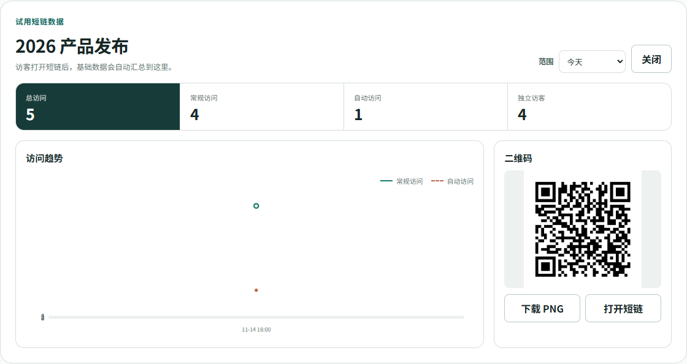
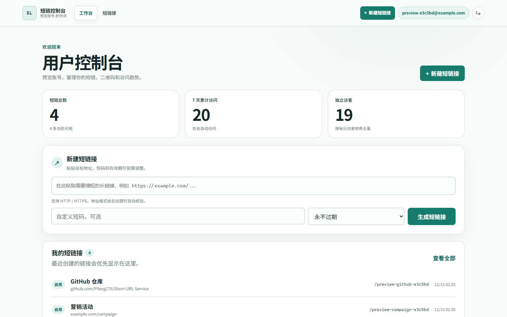
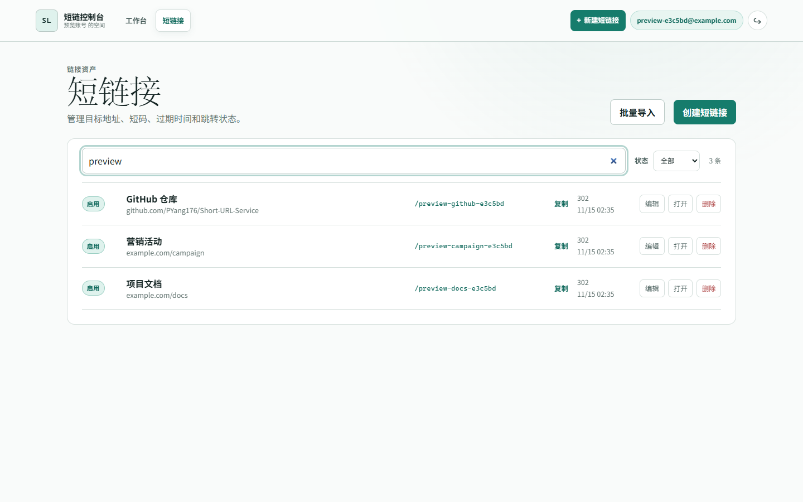
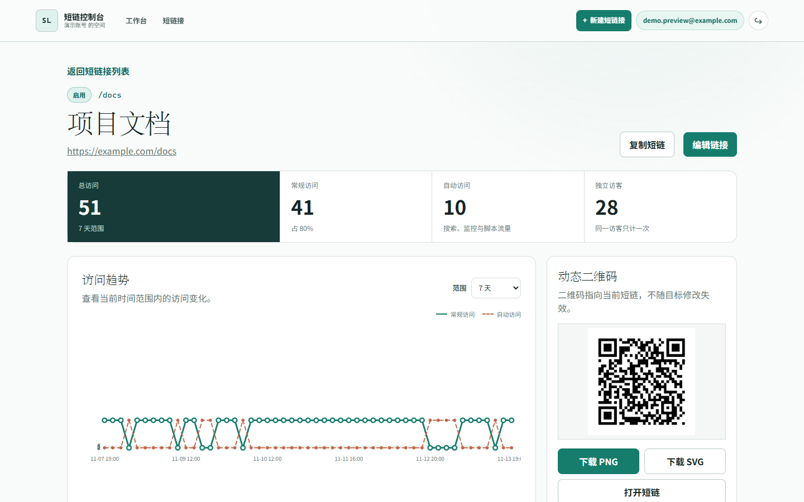
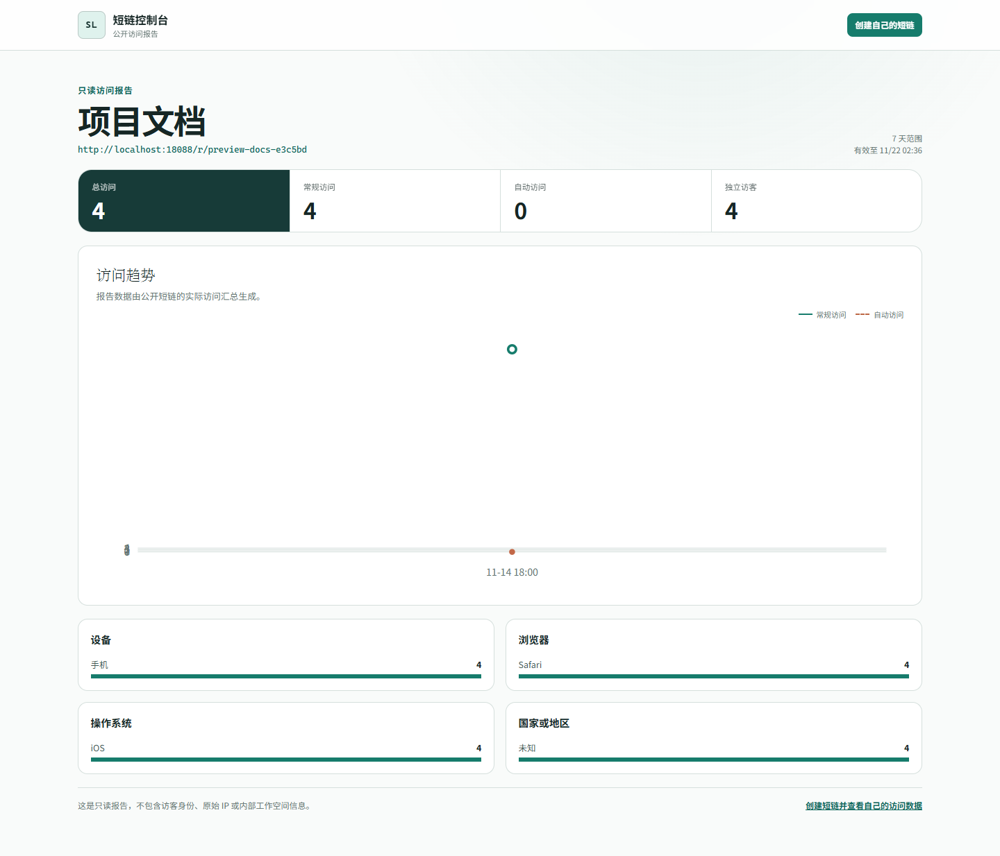
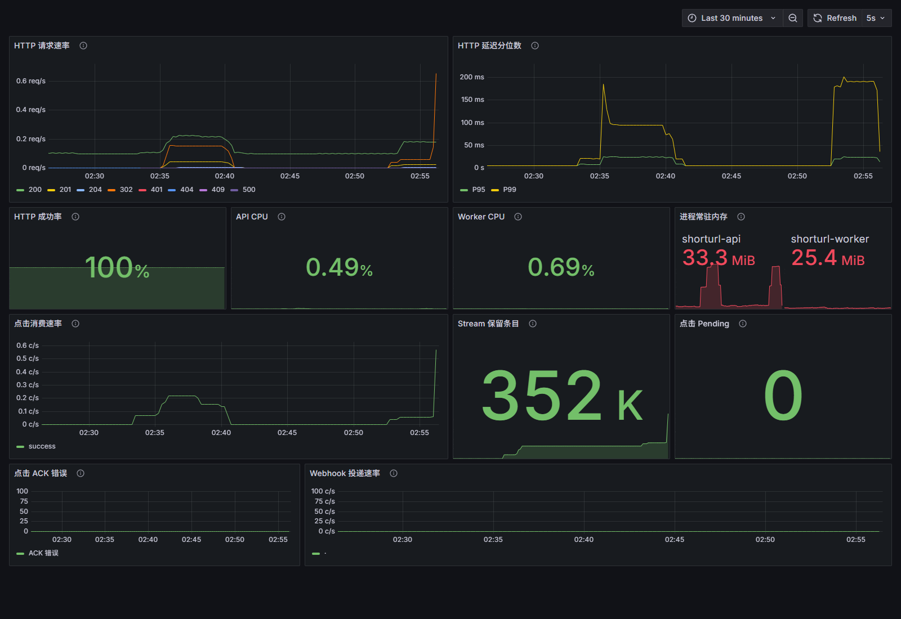
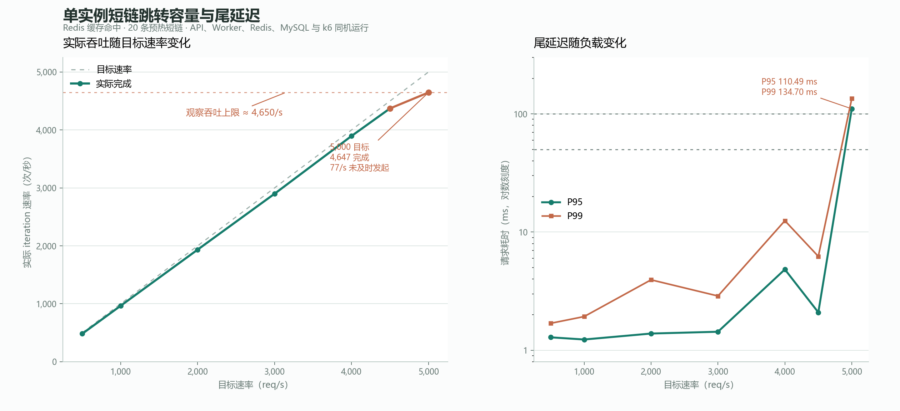

# Short URL Service

基于 Go 和 Vue 3 的短链接管理与访问分析系统。项目覆盖免登录试用、短链创建与
缓存跳转、二维码、访问统计、公开分析分享、批量导入、API Key、Webhook 和
滥用治理。

项目围绕一条完整产品链路设计：游客可直接创建短链，注册后保留数据，并通过
服务端搜索、二维码、趋势分析、公开报告和后台监控完成从创建到运营分析的闭环。
README 同时记录系统架构、实测指标与复现方式，容量和延迟数据均来自仓库内保留的
k6 原始 JSON。

## 1. 项目摘要

本项目的工程验证围绕以下问题：

1. 短链接的创建、查询、缓存跳转、失效和删除能否形成完整闭环。
2. 游客数据在注册后能否安全认领，并继续进入正式工作空间。
3. 点击事件能否通过 Redis Streams 异步落库，且不阻塞公开跳转。
4. 公开分析分享能否在撤销后立即失效，并避免暴露内部标识。
5. 当前单实例配置下的跳转吞吐和尾延迟处于什么范围。

当前结果：

| 项目 | 结果 |
| --- | --- |
| 运行状态 | 可在本地 Docker Compose 环境完整启动 |
| 数据库 | MySQL 8，宿主机原生实例 |
| Redis | 缓存、限流和点击事件 Stream |
| 单实例跳转容量 | 观察吞吐上限约 4,650 req/s |
| 稳定测试上限 | 4,500 req/s 目标下无 HTTP 失败、无未发起迭代 |
| 浏览器验证 | Playwright 覆盖游客、认证、搜索、分析和分享流程 |
| 交付形态 | Docker Compose 单机部署，包含 Web、API、Worker、Redis、Prometheus 和 Grafana |

## 2. 主要界面

| 免登录工作区 | 登录与注册弹窗 |
| --- | --- |
|  |  |

| 游客二维码与访问分析 | 登录后工作台 |
| --- | --- |
|  |  |

| 服务端搜索 | 链接访问分析 |
| --- | --- |
|  |  |

| 公开分享管理 | 公开只读分析报告 |
| --- | --- |
|  |  |

| Grafana 运行监控 |
| --- |
|  |

截图使用 `example.com` 目标和完整的脱敏演示账号生成。最近 7 天趋势数据覆盖
不同日期、设备、浏览器、操作系统、国家及自动访问类型，可稳定复现分析报表。
采集完成后已撤销临时公开分享。

Grafana 截图在停止压测前采集，页面包含 HTTP 成功率、API/Worker CPU、
进程内存、点击消费速率、Stream 保留条目、Pending、ACK 错误和 Webhook 投递
速率。

## 3. 系统设计

```text
Browser
  |
Nginx :18088
  |-- Vue 静态资源
  |-- /api/* -> API :8080
  `-- /r/*   -> API :8080

API
  |-- MySQL：用户、工作空间、短链、点击明细和平台配置
  |-- Redis：跳转缓存、滑动窗口限流和点击事件 Stream
  `-- Redis Streams -> Worker -> MySQL click_events
```

主要数据路径：

1. 创建短链时，API 在 MySQL 中写入业务记录，并在事务内写入幂等结果和
   Webhook Outbox。
2. 公开跳转优先读取 Redis；缓存未命中时回源 MySQL，并通过 `singleflight`
   合并同一短码的并发回源。
3. 跳转成功后写入 Redis Stream。Worker 批量消费事件，并以 `event_id` 唯一
   约束保证重复消费不会产生重复点击记录。
4. 访问分析从 MySQL 点击明细查询汇总、趋势和维度分布。
5. 公开分享只把 Token 的 SHA-256 摘要写入 MySQL，明文 Token 仅在创建响应
   中返回一次。

API、Worker 和迁移任务共用一个应用镜像，仅启动命令不同。Web 使用独立 Nginx
镜像。MySQL 不放入 Docker，Redis 使用 Docker 持久化卷。

## 4. 功能范围

| 模块 | 已实现能力 |
| --- | --- |
| 身份与工作空间 | 注册、登录、Refresh Token 轮换、重放检测、资源归属校验 |
| 免登录试用 | 每会话最多 3 条，有效期 15 分钟至 24 小时，登录后自动认领 |
| 短链生命周期 | 创建、详情、编辑、停用、软删除、游标分页、服务端搜索和状态筛选 |
| 缓存与跳转 | Base62 短码、自定义短码、Redis 缓存、空值缓存、TTL 抖动和主动失效 |
| 二维码 | PNG 与 SVG 动态生成，二维码指向稳定短链 |
| 访问分析 | 总访问、常规/自动访问、独立访客、趋势、设备、系统、浏览器、国家和来源 |
| 数据导出 | 组合筛选后流式导出 CSV，输出字段已完成访客信息脱敏 |
| 公开分享 | 1/7/30 天只读报告，支持查看、复制和立即撤销 |
| 批量操作 | CSV 同步批量创建，最多 500 行，逐行返回结果 |
| 平台能力 | API Key、作用域认证、Webhook Outbox 和投递记录 |
| 治理能力 | 公开举报、管理员审核、违规下架、域名黑名单和审计日志 |
| 可观测性 | 独立指标端口、Prometheus、Grafana、结构化日志和健康检查 |

## 5. 关键链路与并发设计

### 5.1 Redis 滑动窗口限流

限流状态集中保存在 Redis ZSET，单次判断由一段 Lua 脚本原子完成：

```text
ZREMRANGEBYSCORE  删除窗口外请求
ZCARD             读取当前计数
ZADD              允许时写入本次请求
PEXPIRE           刷新窗口过期时间
```

“检查”和“写入”在 Redis 内一次执行，避免多个 API 实例同时先读到低计数再一起放行。
每次请求的 ZSET member 由服务端生成 UUID，客户端无法通过固定 Request ID 绕过计数。

限流维度按接口职责划分：

| 接口 | 限流维度 |
| --- | --- |
| 注册、登录、刷新和公开跳转 | 客户端 IP |
| 登录后的管理接口 | 工作空间 |
| 资源 API | API Key + IP，缺失 Key 时使用工作空间 |
| 创建短链、CSV 导入和公开举报 | 独立业务规则 |

拒绝时返回 `429`、`Retry-After`、`X-RateLimit-Limit` 和
`X-RateLimit-Remaining`。登录、注册等安全敏感接口采用 fail-closed；公开跳转
和一般业务接口按各自规则处理 Redis 故障，保证降级行为可配置。

客户端 IP 只根据配置的可信代理链解析，未受信任来源提供的转发头不会直接进入
限流 Key，降低伪造来源绕过 IP 限制的风险。

### 5.2 跳转缓存与并发回源

公开跳转采用 cache-aside：

```text
Redis 命中 -> 校验状态和时间窗口 -> 返回跳转
Redis 未命中
  -> singleflight 合并同一 domain+slug 的并发回源
  -> 进程内再次检查 Redis
  -> 查询 MySQL
  -> 写回 Redis
  -> 返回跳转
```

`singleflight` 避免同一短码在缓存失效瞬间触发大量 MySQL 查询；Redis 是多个 API
实例共享缓存，进程内回源合并与共享缓存共同降低数据库压力。

- 有效链接缓存 30 分钟，并附加 0 至 5 分钟随机抖动，减少批量过期。
- 链接自身过期时间早于缓存 TTL 时，以链接过期时间为上限。
- 不存在短码写入 1 分钟空值缓存，降低无效 key 对 MySQL 的穿透。
- 更新、停用和删除在数据库提交后主动删除缓存。
- 缓存失效使用脱离客户端取消信号的独立 Context，最多执行 3 次短暂重试。

### 5.3 短链创建幂等与短码竞争

创建接口支持 `Idempotency-Key`：

1. 服务端对请求体计算 SHA-256，并记录 `processing` 或 `completed` 状态。
2. `(workspace_id, idempotency_key)` 是数据库主键，多实例并发请求由唯一约束裁决。
3. 首次请求完成后保存状态码和响应体；重复请求直接返回原响应，并设置
   `Idempotent-Replayed: true`。
4. 相同幂等键但请求体不同，返回 `409 IDEMPOTENCY_MISMATCH`。
5. 首次请求异常中断时，状态可在 30 秒租约后被相同请求接管。

链接业务表同时保存工作空间级幂等键唯一约束。即使“链接已提交、幂等结果尚未完成”
时进程退出，接管请求也能从业务表恢复已有链接，不会重复创建资源。

自定义短码和随机短码最终都由 `(domain_id, slug)` 唯一索引裁决。随机短码发生
碰撞时最多重试 5 次；自定义短码冲突直接返回 `409`。

### 5.4 点击事件异步消费

跳转成功后，API 将点击事件写入 Redis Stream，不把 MySQL 写入放在用户跳转
等待路径中：

```text
HTTP 302
  -> 100ms Context 内 XADD
  -> Worker XReadGroup 批量读取
  -> 单批最多 100 条多行 INSERT IGNORE
  -> 写入成功后 XACK
```

并发与恢复策略：

- Stream 消费组允许多个 Worker 分担消息。
- 数据库写入成功后才 ACK；写入失败保留 Pending，由后续轮次重试。
- Worker 使用 `XAUTOCLAIM` 接管空闲超过 30 秒的其他消费者消息。
- 无法解析的毒消息会单独 ACK，避免无限阻塞消费组。
- `event_id` 是 MySQL 主键，重复投递使用 `INSERT IGNORE` 保持幂等。
- 消费语义为至少一次，不宣称 Exactly Once。

Redis 已同时承担缓存和限流，使用 Streams 可以复用现有基础设施，并通过
Consumer Group、ACK 和 Pending 完成可靠消费，不需要为当前规模额外维护独立消息
中间件。

### 5.5 Webhook Outbox 与任务领取

链接创建、更新和删除与 Webhook Outbox 写入位于同一 MySQL 事务，业务提交成功
后事件不会丢失。

Worker 领取任务时使用：

```sql
SELECT ...
FROM webhook_deliveries
WHERE status = 'pending'
  AND next_attempt_at <= NOW()
  AND (locked_until IS NULL OR locked_until < NOW())
ORDER BY next_attempt_at, id
LIMIT 4
FOR UPDATE SKIP LOCKED;
```

`SKIP LOCKED` 让多个 Worker 可以并行领取不同任务，而不会重复处理同一行。领取后
写入租约时间；成功或失败更新均校验租约，避免锁过期后的旧 Worker 覆盖新结果。

单轮最多受控并发投递 4 个任务，失败使用有上限的指数退避。事务统一采用
“端点 -> 投递记录 -> 端点”的加锁顺序，降低并发事务互相等待的风险。

### 5.6 生命周期与超时控制

- HTTP 请求、数据库、Redis、缓存失效和幂等结果落库均携带 `context.Context`。
- 跳转点击写入使用 100ms 上限，统计链路不会长时间阻塞用户响应。
- 幂等结果落库和缓存删除在业务提交后使用独立且有上限的 Context。
- API、Worker、Prometheus 和 Grafana 提供独立健康检查。
- Worker 的并发任务通过 `context.Context`、`WaitGroup` 和错误 Channel 管理退出。
- 服务收到终止信号后先停止接收请求，再等待在途任务和后台协程结束。

### 5.7 主要实现位置

| 关键链路 | 代码入口 |
| --- | --- |
| 滑动窗口限流 | [limiter.go](internal/platform/ratelimit/limiter.go)、[ratelimit.go](internal/transport/httpapi/ratelimit.go) |
| 缓存回源与主动失效 | [service.go](internal/link/service.go) |
| 创建幂等与数据库唯一约束 | [idempotency.go](internal/platform/idempotency/idempotency.go)、[repository.go](internal/link/repository.go) |
| 点击事件写入与消费 | [recorder.go](internal/analytics/recorder.go)、[worker.go](internal/analytics/worker.go) |
| Webhook Outbox 与任务租约 | [repository.go](internal/webhook/repository.go)、[worker.go](internal/webhook/worker.go) |

## 6. 跳转容量实验

### 6.1 实验目的

测度 Redis 缓存命中时，单 API 实例在不同目标请求速率下的实际吞吐、尾延迟和
异步点击消费积压情况。

### 6.2 测试环境

| 项目 | 配置 |
| --- | --- |
| CPU | AMD Ryzen 7 5800H，8 核 16 线程 |
| 操作系统 | Windows 11 |
| Docker 内存上限 | 15.54 GiB |
| API | `shorturl-app:local`，单实例 |
| Worker | `shorturl-app:local`，单实例 |
| MySQL | 8.0.34，宿主机原生进程 |
| Redis | 7.4 Alpine，Docker 容器 |
| k6 | `grafana/k6:0.57.0`，Docker 容器 |
| 测试短链 | 每个场景 20 条，压测前完成缓存预热 |

API、Worker、Redis、MySQL 和 k6 位于同一台开发机，CPU 和网络资源存在竞争。

### 6.3 方法

```text
创建独立压测账号
  -> 创建 20 条短链
  -> 每条短链访问一次，预热 Redis
  -> constant-arrival-rate 阶梯加压
  -> 请求 /r/{slug}，不跟随目标页跳转
  -> 记录错误率、实际迭代速率、P95、P99 和 dropped_iterations
```

验收阈值为：

```text
http_req_failed < 1%
http_req_duration p(95) < 50 ms
http_req_duration p(99) < 100 ms
checks > 99%
```

500 至 3,000 req/s 场景持续 15 秒；4,000 和 4,500 req/s 场景持续 20 秒。

### 6.4 结果

| 目标速率 | 实际 iteration 速率 | 未发起迭代 | 错误率 | P95 | P99 |
| ---: | ---: | ---: | ---: | ---: | ---: |
| 500/s | 482.13/s | 0 | 0% | 1.29 ms | 1.69 ms |
| 1,000/s | 965.77/s | 0 | 0% | 1.23 ms | 1.93 ms |
| 2,000/s | 1,934.04/s | 0 | 0% | 1.38 ms | 3.94 ms |
| 3,000/s | 2,898.98/s | 0 | 0% | 1.43 ms | 2.88 ms |
| 4,000/s | 3,895.52/s | 0 | 0% | 4.83 ms | 12.48 ms |
| 4,500/s | 4,371.29/s | 0 | 0% | 2.09 ms | 6.23 ms |
| 5,000/s | 4,646.66/s | 1,223（77.03/s） | 0% | 110.49 ms | 134.70 ms |



图 1：目标速率与实际吞吐、P95/P99 延迟的关系。数据源为
`loadtest/reports/redirect-capacity-*.json`，可通过
`python scripts/render-loadtest-chart.py` 重新生成。

### 6.5 结果解释

- 4,500 req/s 目标下检查成功率为 100%，HTTP 错误率为 0%，未发起迭代为 0。
- 5,000 req/s 时实际吞吐约 4,647 req/s，HTTP 错误率保持 0%；k6 在该点进入
  饱和区间，记录到 77.03 次/秒未按计划发起，P95 为 110.49 ms。
- 因此本次环境观察到的吞吐上限约为 4,650 req/s；测试通过至 4,500 req/s，
  但考虑该点已接近饱和，容量规划建议控制在 3,000 至 4,000 req/s。
- 5,000 req/s 饱和时，API CPU 采样峰值约为 701%，Redis 约为 114%，Worker
  约为 34%。瓶颈主要出现在同机 CPU 和 Redis 处理能力。
- 全部场景结束后，Redis 消费组 `pending=0`、`lag=0`，未观察到点击事件积压。

### 6.6 测试口径

- 测试对象是 Redis 缓存命中的公开跳转热路径，对应短链产品的核心访问流量。
- 请求在短链服务返回 302 时结束，完整反映短链服务自身的处理能力。
- API、Worker、Redis、MySQL 与 k6 运行在同一台开发机上，测试覆盖完整本地链路。
- `dropped_iterations` 反映到达速率发生器在饱和点无法继续按计划发起请求；
  对应场景的 HTTP 失败率仍为 0%。
- 当前数据可作为单实例基线，实际部署容量可随 API 实例数、Redis 和宿主机规格扩展。

完整环境、原始数据和时间序列见：

- [容量测试报告](loadtest/reports/redirect-capacity-2026-11-15.md)
- [4,500 req/s JSON](loadtest/reports/redirect-capacity-4500rps.json)
- [5,000 req/s JSON](loadtest/reports/redirect-capacity-5000rps.json)
- [k6 场景](loadtest/redirect.js)

## 7. 技术栈

| 层 | 技术 |
| --- | --- |
| API | Go 1.26.11、Gin、sqlx |
| 数据 | MySQL 8 |
| 缓存与事件 | Redis 7、Redis Streams |
| 前端 | Vue 3、TypeScript、Pinia、Vue Router |
| Web 服务 | Nginx |
| 可观测性 | Prometheus、Grafana、`log/slog` |
| 测试 | Go test、真实 MySQL 集成测试、Playwright、k6 |
| CI | GitHub Actions |

## 8. 快速启动

本地依赖：

- Go 1.26.11
- Node.js 24
- Docker Desktop
- 宿主机 MySQL 8

### 8.1 创建数据库

```sql
CREATE DATABASE short_url
    CHARACTER SET utf8mb4
    COLLATE utf8mb4_unicode_ci;

CREATE USER 'short_url'@'%' IDENTIFIED BY 'change-me';
GRANT ALL PRIVILEGES ON short_url.* TO 'short_url'@'%';
FLUSH PRIVILEGES;
```

### 8.2 配置环境变量

```powershell
Copy-Item deploy\.env.example deploy\.env
```

至少设置：

```text
MYSQL_DSN
JWT_SECRET
ANALYTICS_HASH_SECRET
GRAFANA_ADMIN_PASSWORD
```

### 8.3 构建与启动

```powershell
.\scripts\start.ps1
```

启动脚本会构建 Vue、应用镜像和 Web 镜像，并启动 Redis、迁移任务、API、
Worker、Nginx、Prometheus 与 Grafana。

| 服务 | 地址 |
| --- | --- |
| Web 控制台 | http://localhost:18088 |
| API | http://localhost:18080 |
| API 就绪检查 | http://localhost:18080/health/ready |
| Worker 健康检查 | http://localhost:18081/health/live |
| Prometheus | http://127.0.0.1:19090 |
| Grafana | http://127.0.0.1:13000 |

停止服务：

```powershell
docker compose --env-file deploy\.env -f deploy\docker-compose.yml down
```

迁移任务固定执行 `migrate up`。Goose 在 `goose_db_version` 中记录版本，
重复启动不会重复执行已完成的迁移，也不会清空数据库。

## 9. 测试与质量检查

```powershell
go test ./...
go test -race ./...
go vet ./...
golangci-lint run ./...
```

真实 MySQL 集成测试：

```powershell
$env:SHORTURL_TEST_MYSQL_DSN='user:password@tcp(127.0.0.1:3306)/short_url?parseTime=true&loc=UTC'
go test -tags=integration ./...
```

前端检查：

```powershell
Set-Location web
npm run typecheck
npm run build
```

浏览器端到端验收：

```powershell
$env:SHORTURL_WEBHOOK_TARGET_HOST='127.0.0.1'
python web\scripts\e2e.py
```

当前 E2E 覆盖免登录试用、注册认领、普通用户权限、指标端口隔离、短链创建、
公开举报、访问分析、二维码下载、编辑、服务端搜索、公开分享和撤销失效。

生成带 7 天趋势的演示数据：

```powershell
$env:SHORTURL_MYSQL_DSN='user:password@tcp(127.0.0.1:3306)/short_url?parseTime=true&loc=UTC'
.\scripts\seed-demo.ps1 -Email demo@example.com -HistoryDays 7 -ResetHistory
```

`-ResetHistory` 只清空目标演示工作空间的点击事件，再写入稳定种子数据。
重复执行相同种子不会重复累加相同历史记录。

## 10. 核心接口

```text
POST   /api/v1/auth/register
POST   /api/v1/auth/login
POST   /api/v1/auth/refresh

POST   /api/v1/trial/links
GET    /api/v1/trial/links
GET    /api/v1/trial/links/{id}/analytics
GET    /api/v1/trial/links/{id}/qr
POST   /api/v1/trial/claim

POST   /api/v1/links
POST   /api/v1/links/bulk
GET    /api/v1/links?q={keyword}&status={1|2}
GET    /api/v1/links/{id}
PATCH  /api/v1/links/{id}
DELETE /api/v1/links/{id}

GET    /api/v1/links/{id}/analytics
GET    /api/v1/analytics/overview
GET    /api/v1/analytics/export
POST   /api/v1/links/{id}/shares
GET    /api/v1/links/{id}/shares
DELETE /api/v1/links/{id}/shares/{shareId}
GET    /api/v1/public/reports/{token}

GET    /r/{slug}
GET    /{slug}
```

OpenAPI 3.1 文档位于 [web/public/openapi.yaml](web/public/openapi.yaml)。

## 11. 安全与可靠性

- 注册、登录、刷新、管理 API、创建短链、CSV 导入、公开举报和公开跳转分别
  使用 Redis 滑动窗口限流。
- 创建短链支持 `Idempotency-Key`；重复请求返回首次创建结果，并设置
  `Idempotent-Replayed: true`。
- 点击事件使用 Redis Streams、Consumer Group、ACK 和 Pending 接管，至少一次
  消费，通过 MySQL 事件 ID 唯一约束实现幂等。
- Webhook 使用事务型 Outbox、HMAC-SHA256 签名、指数退避和有上限重试。
- API Key 和公开分享 Token 明文只在创建时返回，数据库只保存摘要。
- 公开分析报告不返回工作空间 ID、链接 ID、访客哈希或原始 IP。
- Prometheus 指标监听独立容器内网端口，不通过公开 `/metrics` 暴露。
- Nginx 在后端容器重启后重新解析 API 地址，避免继续连接旧容器 IP。

## 12. 文档

- [需求规格](docs/需求规格.md)
- [架构设计](docs/架构设计.md)
- [数据库设计](docs/数据库设计.md)
- [接口设计](docs/接口设计.md)
- [开发路线](docs/开发路线.md)
- [发布验收](docs/发布验收.md)
- [部署与监控](deploy/README.md)
- [工程协作规则](AGENTS.md)

## 13. 运行说明

- MySQL 保存用户、工作空间、短链和点击明细等权威数据；Redis 负责缓存、限流
  与点击事件缓冲。
- 点击分析直接聚合 MySQL 明细，支持当前产品所需的趋势、设备、浏览器、系统、
  国家和来源维度。
- 自动访问根据请求头特征识别，并在界面中作为独立指标呈现。
- 前端 Token 存储与 CSP、严格 JSON、请求体限制、可信代理边界共同组成浏览器端
  安全策略。
- 自定义域名提供 TXT/CNAME 验证和 Host 路由，部署时可通过 DNS 与反向代理
  接入 HTTPS。
