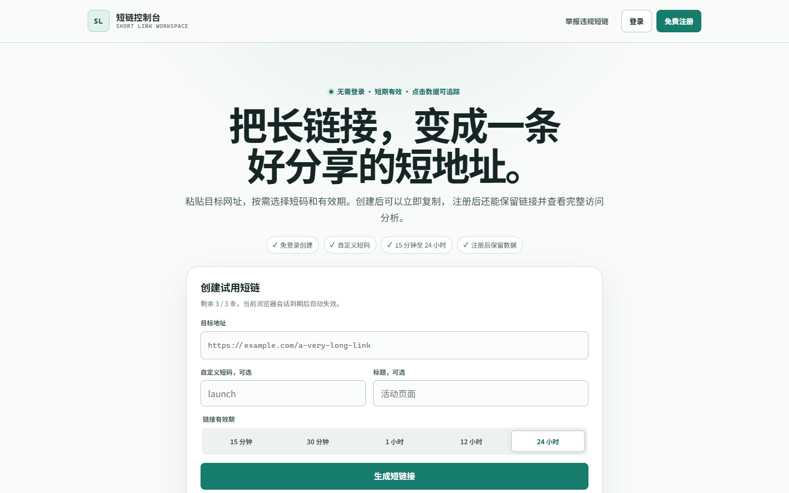
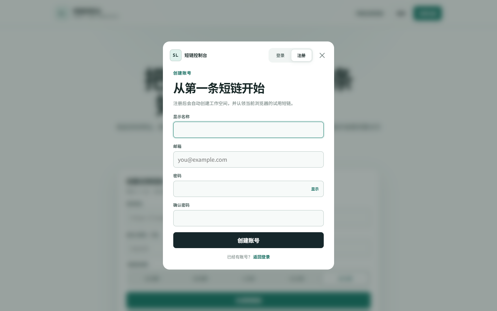

# Short URL Service

基于 Go 和 Vue 3 的短链接管理与访问分析系统。项目覆盖免登录试用、短链创建与
缓存跳转、二维码、访问统计、公开分析分享、批量导入、API Key、Webhook 和
滥用治理。

本 README 按“系统范围、界面、设计、实验方法、实测结果、复现方式”组织。
文中的容量和延迟数据均来自仓库内保留的 k6 原始 JSON，不使用估算值。

## 1. 项目摘要

本项目的工程验证围绕以下问题：

1. 短链接的创建、查询、缓存跳转、失效和删除能否形成完整闭环。
2. 游客数据在注册后能否安全认领，并继续进入正式工作空间。
3. 点击事件能否通过 Redis Streams 异步落库，且不阻塞公开跳转。
4. 公开分析分享能否在撤销后立即失效，并避免暴露内部标识。
5. 当前单实例配置下的跳转吞吐和尾延迟处于什么范围。

当前结果：

| 项目 | 结果 |
| --- | --- |
| 运行状态 | 可在本地 Docker Compose 环境完整启动 |
| 数据库 | MySQL 8，宿主机原生实例 |
| Redis | 缓存、限流和点击事件 Stream |
| 单实例跳转容量 | 观察吞吐上限约 4,650 req/s |
| 稳定测试上限 | 4,500 req/s 目标下无 HTTP 失败、无未发起迭代 |
| 浏览器验证 | Playwright 覆盖游客、认证、搜索、分析和分享流程 |
| 公网状态 | 尚未部署，不声明公网 SLA |

## 2. 主要界面

| 免登录工作区 | 登录与注册弹窗 |
| --- | --- |
|  |  |

| 游客二维码与访问分析 | 登录后工作台 |
| --- | --- |
|  |  |

| 服务端搜索 | 链接访问分析 |
| --- | --- |
|  |  |

| 公开分享管理 | 公开只读分析报告 |
| --- | --- |
|  |  |

| Grafana 运行监控 |
| --- |
|  |

截图使用 `example.com` 目标和临时演示账号生成。访问趋势使用确定性生成的
最近 7 天演示点击数据，仅用于展示功能，不代表真实业务流量。截图中的公开分享
在采集完成后已撤销，不包含真实用户数据或有效分享 Token。

Grafana 截图在停止压测前采集，页面包含 HTTP 成功率、API/Worker CPU、
进程内存、点击消费速率、Stream 保留条目、Pending、ACK 错误和 Webhook 投递
速率。

## 3. 系统设计

```text
Browser
  |
Nginx :18088
  |-- Vue 静态资源
  |-- /api/* -> API :8080
  `-- /r/*   -> API :8080

API
  |-- MySQL：用户、工作空间、短链、点击明细和平台配置
  |-- Redis：跳转缓存、滑动窗口限流和点击事件 Stream
  `-- Redis Streams -> Worker -> MySQL click_events
```

主要数据路径：

1. 创建短链时，API 在 MySQL 中写入业务记录，并在事务内写入幂等结果和
   Webhook Outbox。
2. 公开跳转优先读取 Redis；缓存未命中时回源 MySQL，并通过 `singleflight`
   合并同一短码的并发回源。
3. 跳转成功后写入 Redis Stream。Worker 批量消费事件，并以 `event_id` 唯一
   约束保证重复消费不会产生重复点击记录。
4. 访问分析从 MySQL 点击明细查询汇总、趋势和维度分布。
5. 公开分享只把 Token 的 SHA-256 摘要写入 MySQL，明文 Token 仅在创建响应
   中返回一次。

API、Worker 和迁移任务共用一个应用镜像，仅启动命令不同。Web 使用独立 Nginx
镜像。MySQL 不放入 Docker，Redis 使用 Docker 持久化卷。

## 4. 功能范围

| 模块 | 已实现能力 |
| --- | --- |
| 身份与工作空间 | 注册、登录、Refresh Token 轮换、重放检测、资源归属校验 |
| 免登录试用 | 每会话最多 3 条，有效期 15 分钟至 24 小时，登录后自动认领 |
| 短链生命周期 | 创建、详情、编辑、停用、软删除、游标分页、服务端搜索和状态筛选 |
| 缓存与跳转 | Base62 短码、自定义短码、Redis 缓存、空值缓存、TTL 抖动和主动失效 |
| 二维码 | PNG 与 SVG 动态生成，二维码指向稳定短链 |
| 访问分析 | 总访问、常规/自动访问、独立访客、趋势、设备、系统、浏览器、国家和来源 |
| 数据导出 | 组合筛选后流式导出 CSV，不包含原始 IP 或访客哈希 |
| 公开分享 | 1/7/30 天只读报告，支持查看、复制和立即撤销 |
| 批量操作 | CSV 同步批量创建，最多 500 行，逐行返回结果 |
| 平台能力 | API Key、作用域认证、Webhook Outbox 和投递记录 |
| 治理能力 | 公开举报、管理员审核、违规下架、域名黑名单和审计日志 |
| 可观测性 | 独立指标端口、Prometheus、Grafana、结构化日志和健康检查 |

## 5. 跳转容量实验

### 5.1 实验目的

测度 Redis 缓存命中时，单 API 实例在不同目标请求速率下的实际吞吐、尾延迟和
异步点击消费积压情况。

### 5.2 测试环境

| 项目 | 配置 |
| --- | --- |
| CPU | AMD Ryzen 7 5800H，8 核 16 线程 |
| 操作系统 | Windows 11 |
| Docker 内存上限 | 15.54 GiB |
| API | `shorturl-app:local`，单实例 |
| Worker | `shorturl-app:local`，单实例 |
| MySQL | 8.0.34，宿主机原生进程 |
| Redis | 7.4 Alpine，Docker 容器 |
| k6 | `grafana/k6:0.57.0`，Docker 容器 |
| 测试短链 | 每个场景 20 条，压测前完成缓存预热 |

API、Worker、Redis、MySQL 和 k6 位于同一台开发机，CPU 和网络资源存在竞争。

### 5.3 方法

```text
创建独立压测账号
  -> 创建 20 条短链
  -> 每条短链访问一次，预热 Redis
  -> constant-arrival-rate 阶梯加压
  -> 请求 /r/{slug}，不跟随目标页跳转
  -> 记录错误率、实际迭代速率、P95、P99 和 dropped_iterations
```

验收阈值为：

```text
http_req_failed < 1%
http_req_duration p(95) < 50 ms
http_req_duration p(99) < 100 ms
checks > 99%
```

500 至 3,000 req/s 场景持续 15 秒；4,000 和 4,500 req/s 场景持续 20 秒。

### 5.4 结果

| 目标速率 | 实际 iteration 速率 | 未发起迭代 | 错误率 | P95 | P99 |
| ---: | ---: | ---: | ---: | ---: | ---: |
| 500/s | 482.13/s | 0 | 0% | 1.29 ms | 1.69 ms |
| 1,000/s | 965.77/s | 0 | 0% | 1.23 ms | 1.93 ms |
| 2,000/s | 1,934.04/s | 0 | 0% | 1.38 ms | 3.94 ms |
| 3,000/s | 2,898.98/s | 0 | 0% | 1.43 ms | 2.88 ms |
| 4,000/s | 3,895.52/s | 0 | 0% | 4.83 ms | 12.48 ms |
| 4,500/s | 4,371.29/s | 0 | 0% | 2.09 ms | 6.23 ms |
| 5,000/s | 4,646.66/s | 1,223（77.03/s） | 0% | 110.49 ms | 134.70 ms |


图 1：目标速率与实际吞吐、P95/P99 延迟的关系。数据源为
`loadtest/reports/redirect-capacity-*.json`，可通过
`python scripts/render-loadtest-chart.py` 重新生成。

### 5.5 结果解释

- 4,500 req/s 目标下没有 HTTP 错误，也没有因 VU 不足而未发起的请求。
- 5,000 req/s 时实际吞吐约 4,647 req/s，HTTP 错误率仍为 0%，但 k6 已有
  77.03 次/秒的请求无法按计划发起，P95 升至 110.49 ms。
- 因此本次环境观察到的吞吐上限约为 4,650 req/s；测试通过至 4,500 req/s，
  但考虑该点已接近饱和，容量规划建议控制在 3,000 至 4,000 req/s。
- 5,000 req/s 饱和时，API CPU 采样峰值约为 701%，Redis 约为 114%，Worker
  约为 34%。瓶颈主要出现在同机 CPU 和 Redis 处理能力。
- 全部场景结束后，Redis 消费组 `pending=0`、`lag=0`，未观察到点击事件积压。

4,500 req/s 的 P95 低于 4,000 req/s，属于 GC、调度和宿主机资源波动，不表示
负载升高后延迟必然下降。

### 5.6 效度与限制

- 仅覆盖 Redis 缓存命中的公开跳转路径，不覆盖管理接口和缓存未命中容量。
- 不跟随 302 目标页，不包含目标网站响应时间。
- 请求直接进入隔离 API 容器，不包含公网 DNS、TLS 和真实网络链路损耗。
- k6 与 API 同机运行，压测工具本身也消耗 CPU。
- 5,000 req/s 场景没有 HTTP 失败；失败指标来自 k6 无法按计划发起全部请求，
  不等同于网关返回 5xx。
- 结果不能直接推导多实例、生产 Redis 或云主机容量，也不能作为公网 SLA。

完整环境、原始数据和时间序列见：

- [容量测试报告](loadtest/reports/redirect-capacity-2026-11-15.md)
- [4,500 req/s JSON](loadtest/reports/redirect-capacity-4500rps.json)
- [5,000 req/s JSON](loadtest/reports/redirect-capacity-5000rps.json)
- [k6 场景](loadtest/redirect.js)

## 6. 技术栈

| 层 | 技术 |
| --- | --- |
| API | Go 1.26.11、Gin、sqlx |
| 数据 | MySQL 8 |
| 缓存与事件 | Redis 7、Redis Streams |
| 前端 | Vue 3、TypeScript、Pinia、Vue Router |
| Web 服务 | Nginx |
| 可观测性 | Prometheus、Grafana、`log/slog` |
| 测试 | Go test、真实 MySQL 集成测试、Playwright、k6 |
| CI | GitHub Actions |

## 7. 快速启动

本地依赖：

- Go 1.26.11
- Node.js 24
- Docker Desktop
- 宿主机 MySQL 8

### 7.1 创建数据库

```sql
CREATE DATABASE short_url
    CHARACTER SET utf8mb4
    COLLATE utf8mb4_unicode_ci;

CREATE USER 'short_url'@'%' IDENTIFIED BY 'change-me';
GRANT ALL PRIVILEGES ON short_url.* TO 'short_url'@'%';
FLUSH PRIVILEGES;
```

### 7.2 配置环境变量

```powershell
Copy-Item deploy\.env.example deploy\.env
```

至少设置：

```text
MYSQL_DSN
JWT_SECRET
ANALYTICS_HASH_SECRET
GRAFANA_ADMIN_PASSWORD
```

### 7.3 构建与启动

```powershell
.\scripts\start.ps1
```

启动脚本会构建 Vue、应用镜像和 Web 镜像，并启动 Redis、迁移任务、API、
Worker、Nginx、Prometheus 与 Grafana。

| 服务 | 地址 |
| --- | --- |
| Web 控制台 | http://localhost:18088 |
| API | http://localhost:18080 |
| API 就绪检查 | http://localhost:18080/health/ready |
| Worker 健康检查 | http://localhost:18081/health/live |
| Prometheus | http://127.0.0.1:19090 |
| Grafana | http://127.0.0.1:13000 |

停止服务：

```powershell
docker compose --env-file deploy\.env -f deploy\docker-compose.yml down
```

迁移任务固定执行 `migrate up`。Goose 在 `goose_db_version` 中记录版本，
重复启动不会重复执行已完成的迁移，也不会清空数据库。

## 8. 测试与质量检查

```powershell
go test ./...
go test -race ./...
go vet ./...
golangci-lint run ./...
```

真实 MySQL 集成测试：

```powershell
$env:SHORTURL_TEST_MYSQL_DSN='user:password@tcp(127.0.0.1:3306)/short_url?parseTime=true&loc=UTC'
go test -tags=integration ./...
```

前端检查：

```powershell
Set-Location web
npm run typecheck
npm run build
```

浏览器端到端验收：

```powershell
$env:SHORTURL_WEBHOOK_TARGET_HOST='127.0.0.1'
python web\scripts\e2e.py
```

当前 E2E 覆盖免登录试用、注册认领、普通用户权限、指标端口隔离、短链创建、
公开举报、访问分析、二维码下载、编辑、服务端搜索、公开分享和撤销失效。

生成带 7 天趋势的演示数据：

```powershell
$env:SHORTURL_MYSQL_DSN='user:password@tcp(127.0.0.1:3306)/short_url?parseTime=true&loc=UTC'
.\scripts\seed-demo.ps1 -Email demo@example.com -HistoryDays 7 -ResetHistory
```

`-ResetHistory` 只清空目标演示工作空间的点击事件，再写入稳定种子数据。
重复执行相同种子不会重复累加相同历史记录。

## 9. 核心接口

```text
POST   /api/v1/auth/register
POST   /api/v1/auth/login
POST   /api/v1/auth/refresh

POST   /api/v1/trial/links
GET    /api/v1/trial/links
GET    /api/v1/trial/links/{id}/analytics
GET    /api/v1/trial/links/{id}/qr
POST   /api/v1/trial/claim

POST   /api/v1/links
POST   /api/v1/links/bulk
GET    /api/v1/links?q={keyword}&status={1|2}
GET    /api/v1/links/{id}
PATCH  /api/v1/links/{id}
DELETE /api/v1/links/{id}

GET    /api/v1/links/{id}/analytics
GET    /api/v1/analytics/overview
GET    /api/v1/analytics/export
POST   /api/v1/links/{id}/shares
GET    /api/v1/links/{id}/shares
DELETE /api/v1/links/{id}/shares/{shareId}
GET    /api/v1/public/reports/{token}

GET    /r/{slug}
GET    /{slug}
```

OpenAPI 3.1 文档位于 [web/public/openapi.yaml](web/public/openapi.yaml)。

## 10. 安全与可靠性

- 注册、登录、刷新、管理 API、创建短链、CSV 导入、公开举报和公开跳转分别
  使用 Redis 滑动窗口限流。
- 创建短链支持 `Idempotency-Key`；重复请求返回首次创建结果，并设置
  `Idempotent-Replayed: true`。
- 点击事件使用 Redis Streams、Consumer Group、ACK 和 Pending 接管，至少一次
  消费，通过 MySQL 事件 ID 唯一约束实现幂等。
- Webhook 使用事务型 Outbox、HMAC-SHA256 签名、指数退避和有上限重试。
- API Key 和公开分享 Token 明文只在创建时返回，数据库只保存摘要。
- 公开分析报告不返回工作空间 ID、链接 ID、访客哈希或原始 IP。
- Prometheus 指标监听独立容器内网端口，不通过公开 `/metrics` 暴露。
- Nginx 在后端容器重启后重新解析 API 地址，避免继续连接旧容器 IP。

## 11. 文档

- [需求规格](docs/需求规格.md)
- [架构设计](docs/架构设计.md)
- [数据库设计](docs/数据库设计.md)
- [接口设计](docs/接口设计.md)
- [开发路线](docs/开发路线.md)
- [发布验收](docs/发布验收.md)
- [部署与监控](deploy/README.md)
- [工程协作规则](AGENTS.md)

## 12. 当前边界

- 点击分析当前直接查询 MySQL 明细，尚未建立预聚合表。
- 自动访问标记基于请求头特征的启发式规则，不代表已验证真人。
- 浏览器使用 `localStorage` 保存 Access Token 和 Refresh Token；CSP 可降低
  脚本注入风险，但不能替代 HttpOnly Cookie 和 CSRF 防护。
- 自定义域名的本地 TXT/CNAME 校验和 Host 路由已实现，生产 DNS 与自动 HTTPS
  证书尚未验收。
- 当前未实现文件夹、标签、用户封禁和团队角色。
- 项目未部署公网，README 中的容量数据不构成生产 SLA。
